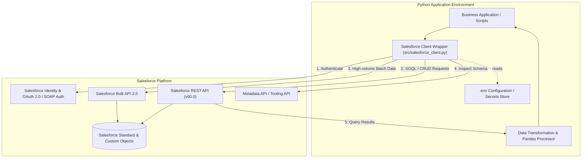
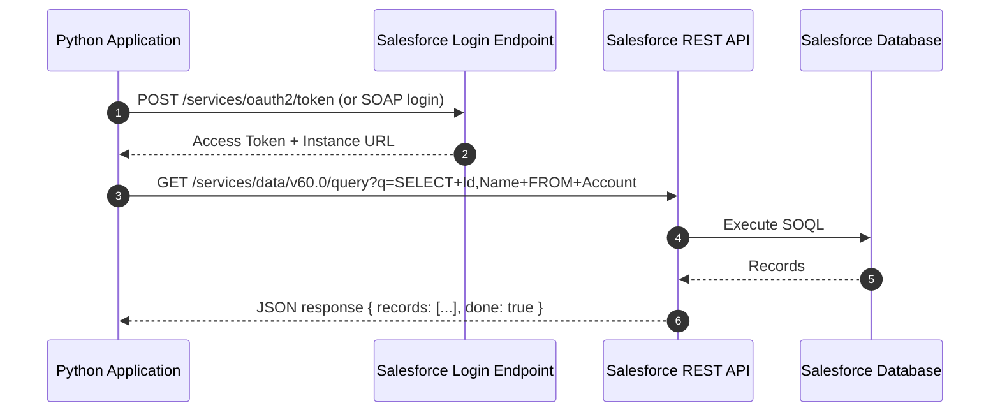

# High-Level System Architecture

This document describes the high-level architecture of the Python & Salesforce integration platform.

---

## 1. System Context & Overview

The system acts as an integration bridge between local Python automation / data analytics workloads and Salesforce CRM (Sales Cloud, Service Cloud, custom objects).

---

## 2. Core Architectural Components

### 2.1 Configuration & Secret Management
- Local configurations are sourced from `.env` via `python-dotenv`.
- Production and automated CI/CD runners inject credentials via environment variables or secret vaults (e.g., AWS Secrets Manager, Azure Key Vault, or HashiCorp Vault).
- No sensitive keys or tokens are stored in source control (enforced via `.gitignore`).

### 2.2 Salesforce Client Wrapper
- Encapsulates authentication session lifecycle and re-authentication on token expiry.
- Provides unified abstraction across:
  - Standard REST API operations (record queries, inserts, updates, deletes).
  - Bulk API 2.0 queries and batch operations for large datasets (>10,000 records).
  - Raw SOQL query execution with automated pagination.

### 2.3 Data Transformation Engine
- Converts Salesforce JSON responses into typed Python models or `pandas.DataFrame` structures for ETL operations.
- Manages timezone normalization (Salesforce UTC timestamps to local application time) and nested relationship traversal (e.g., `Account.Owner.Name`).

---

## 3. Network & Connectivity Model

---

## 4. Scalability & Performance Strategies

- **SOQL Query Optimization**: Always filter using indexed fields (`Id`, `ExternalId`, `CreatedDate`, `RecordType`).
- **Bulk API vs REST API**:
  - `< 2,000 records`: Synchronous REST API.
  - `> 2,000 records`: Asynchronous Bulk API 2.0 to minimize API limit consumption.
- **Connection Reuse**: Persist the `requests.Session` created by `simple-salesforce` to leverage HTTP keep-alive connections.
