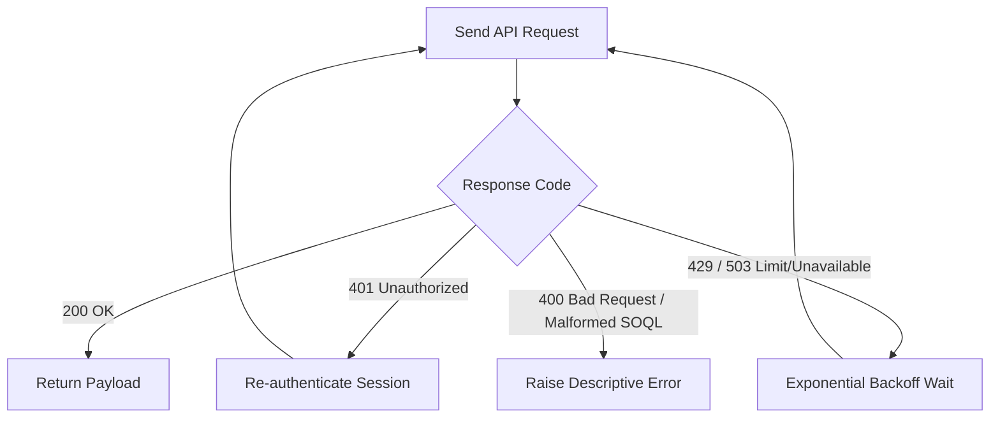

# Component Design

This document details the internal design and module contracts for the Python Salesforce client application.

---

## 1. Module Hierarchy

```text
src/
├── __init__.py               # Package metadata
├── salesforce_client.py      # Core connection & query abstraction
├── config.py                 # (Planned) Strongly-typed configuration schema (pydantic/dataclasses)
├── models/                   # (Planned) Typed data transfer objects (DTOs)
└── utils/                    # (Planned) Logging, rate-limiting, and error-handling utilities
```

---

## 2. Component Specifications

### 2.1 Connection Provider (`salesforce_client.py`)

- **Role**: Establishes, tests, and validates connection against Salesforce endpoints.
- **Contract**:
  ```python
  def get_salesforce_connection() -> Salesforce:
      """Returns an authenticated simple-salesforce Salesforce instance."""
  ```
- **Error Handling**:
  - `ValueError`: Raised if essential environment variables (`SALESFORCE_USERNAME`, `SALESFORCE_PASSWORD`) are missing.
  - `SalesforceAuthenticationFailed`: Raised if credentials or security token are rejected.
  - `requests.exceptions.ConnectionError`: Raised on network/DNS unreachable errors.

### 2.2 Query Runner & Paginated Extractor

- **Role**: Executes SOQL queries with automatic pagination via `nextRecordsUrl`.
- **Interface**:
  ```python
  def query_all(sf: Salesforce, soql: str) -> list[dict]:
      """Executes query and exhausts all paginated batches until done == True."""
  ```

---

## 3. Error Handling & Retry Matrix


