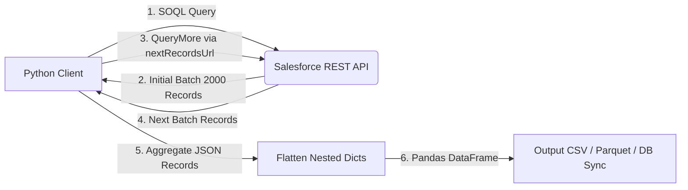
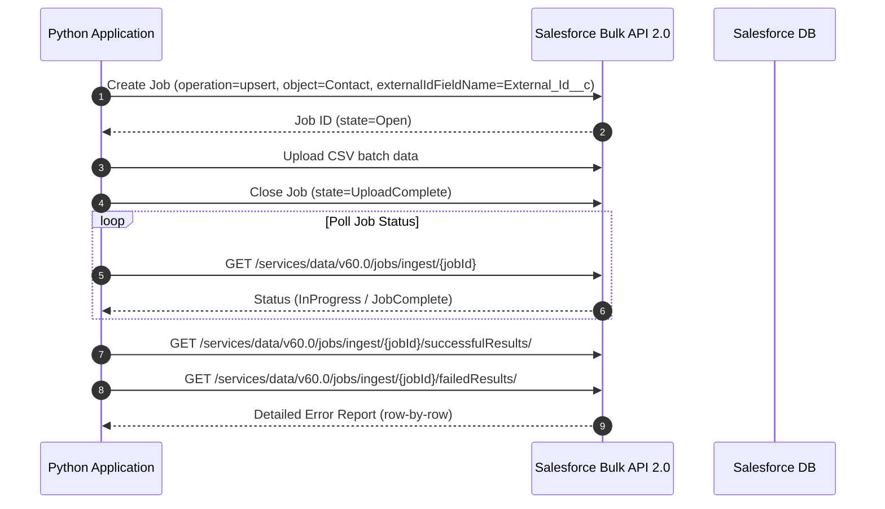

# Data Flow & Transformation Design

This document details data flow pipelines for reading from and writing to Salesforce.

---

## 1. SOQL Query Ingestion Flow

### Steps:
1. **Query Construction**: Ensure field selection explicitly names required fields (avoid `SELECT FIELDS(ALL)` in automated integrations due to performance penalties).
2. **Relationship Flattening**: Flatten parent fields (e.g. `Account.Owner.Email` -> `Account_Owner_Email`) to provide clean tabular data structures.
3. **Type Casting**: Map Salesforce datatypes (`xsd:dateTime`, `xsd:boolean`, `xsd:double`) to Python native or Pandas datatypes.

---

## 2. Bulk Ingestion / Upsert Flow

For writing large volumes (>10,000 records) to Salesforce:

