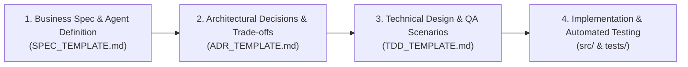

# Engineering & Agent Specification Templates

This directory provides standardized templates designed to streamline the lifecycle of software features, architectural decisions, and agent-driven development.

---

## 🔄 The 3-Stage Development Lifecycle



---

## 📁 Available Templates

| Template | Purpose | Driving Discovery Questions Included |
| :--- | :--- | :--- |
| [**`SPEC_TEMPLATE.md`**](./SPEC_TEMPLATE.md) | Defines business domain requirements and generates autonomous agent / skill instructions. | • How does the business currently run this process?<br>• Who are the personas and what are the pain points?<br>• What are the Salesforce business rules, SLAs, and failure escalations?<br>• What are the agent prompts, tools, and safety guardrails? |
| [**`ADR_TEMPLATE.md`**](./ADR_TEMPLATE.md) | Documents architectural choices, trade-offs, and technology evaluations. | • Why is an ADR needed instead of a simple code change?<br>• Which Spec requirement or constraint prompted this?<br>• What Salesforce platform limits (API quotas, Governor Limits) apply?<br>• What are the security, credential, and compliance impacts? |
| [**`TDD_TEMPLATE.md`**](./TDD_TEMPLATE.md) | Details code/schema modifications, unit test plans, and QA verification matrices. | • What code and schema changes are introduced?<br>• How does QA independently verify this end-to-end?<br>• How are network errors, rate limits, and invalid inputs handled?<br>• What mock fixtures or sandbox test data are required? |

---

## 🛠️ Usage Guidelines

1. **Creating a new feature / specification**:
   - Create a container folder under `doc/spec/<SPEC-Number - Spec Reason>/`.
   - Generate the **4 mandatory baseline files**:
     - `Requirement.md` (based on `SPEC_TEMPLATE.md`)
     - `Implementation_plan.md`
     - `TDD.md` (based on `TDD_TEMPLATE.md`)
     - `Scenario.md` (QA scenarios from `TDD_TEMPLATE.md`)
2. **Conditional 5th File: `ADR-<Count>.md`**:
   - Author `ADR-<Count>.md` **ONLY IF** the spec is large, complex, or introduces major architectural decisions (e.g. cross-system sync, new libraries, OAuth JWT flows, or Salesforce Governor / 24-hr API quota impacts).
   - Routine, small, or straightforward tasks **do not** require an ADR.
3. **Mandatory Codebase Map Synchronization**:
   - Immediately update `CODEBASE_MAP.md` and verify with:
     ```powershell
     .venv\Scripts\python.exe .agents\scripts\verify_and_sync_map.py
     ```
